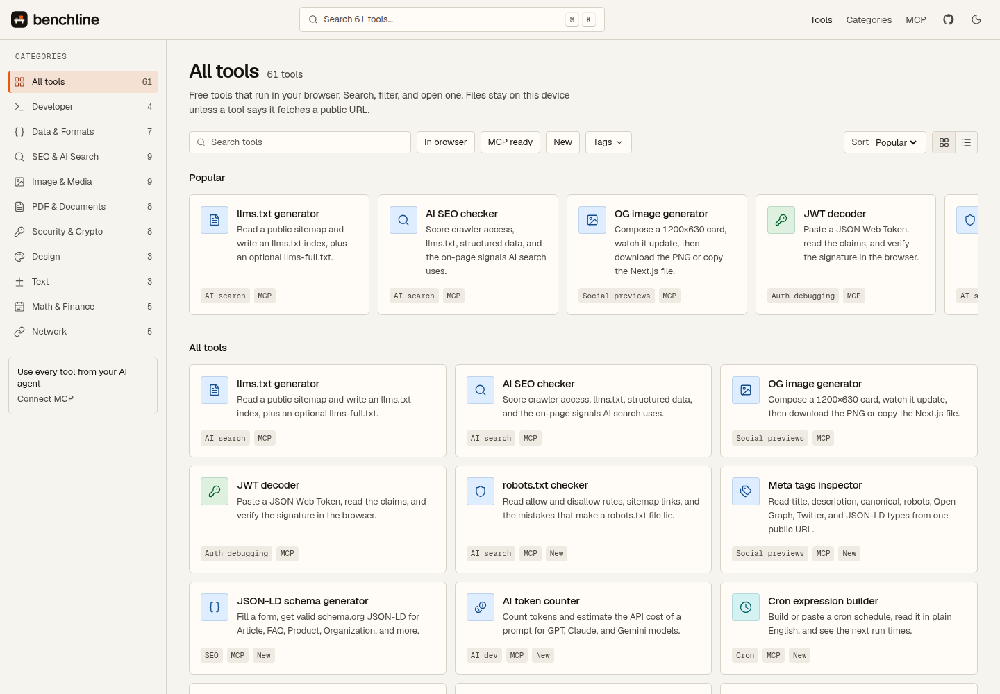
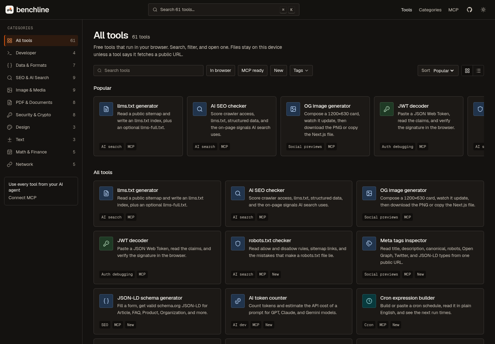
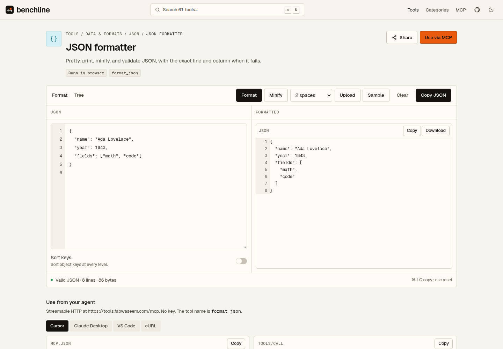
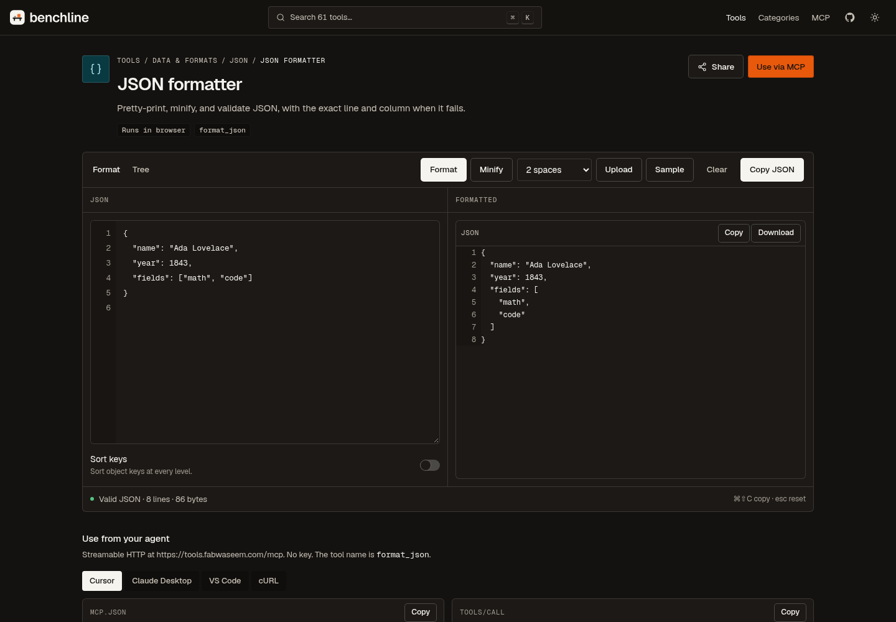

<p align="center">
  
</p>

<h1 align="center">Benchline</h1>

<p align="center">
  <a href="LICENSE"></a>
  <a href="https://tools.fabwaseem.com"></a>
  <a href="https://tools.fabwaseem.com/mcp/guide"></a>
  <a href="CONTRIBUTING.md"></a>
</p>

Benchline is a free directory of browser tools for the small, exact jobs around shipping software: JSON, PDFs, images, tokens, headers, and the files a crawler can cite. Each tool is a pure function with a page on the site and the same function on a stateless MCP server. Nothing is stored. A tool runs in the browser unless its job is to read a public URL.

**Live:** [https://tools.fabwaseem.com](https://tools.fabwaseem.com)

## Screenshots

<table>
  <tr>
    <td></td>
    <td></td>
  </tr>
  <tr>
    <td></td>
    <td></td>
  </tr>
</table>

The directory is the home page. The JSON formatter is one tool page (`/t/json-formatter`).

## Features

- A searchable directory, with categories, tags, and a command palette on ⌘K. Filtering runs in the browser.
- One folder per tool: metadata, a client page, and pure `lib/` covered by vitest.
- A stateless Streamable HTTP MCP server at [`/mcp`](https://tools.fabwaseem.com/mcp). No API key and no session.
- The same functions over HTTP at `POST /api/v1/tools/<slug>`, with an OpenAPI document at [`/openapi.json`](https://tools.fabwaseem.com/openapi.json).
- [`/llms.txt`](https://tools.fabwaseem.com/llms.txt) and [`/llms-full.txt`](https://tools.fabwaseem.com/llms-full.txt), generated from the registry.
- Light and dark themes. Corner radii stay on the small token scale.

## Tools

<!-- tools:start -->

76 tools, in `toolOrder`. Run `pnpm gen:readme-tools` after adding one.

### Developer

Build files, schedules, and the small programs a deploy depends on.

**Cron.** Build a cron expression and read the next runs.

- [Cron expression builder](https://tools.fabwaseem.com/t/cron-expression-builder) — Build or paste a cron schedule, read it in plain English, and see the next run times.

**Next.js.** Production files for shipping a Next.js app in a container.

- [Next.js Dockerfile generator](https://tools.fabwaseem.com/t/nextjs-dockerfile-generator) — Generate a production multi-stage Dockerfile for Next.js, plus .dockerignore and compose.

**Fixtures.** Placeholder copy and seeded rows for a schema.

- [Lorem ipsum](https://tools.fabwaseem.com/t/lorem-ipsum) — Placeholder copy, or fake rows as JSON, CSV, and SQL, from a seed.

**Regex.** Test a JavaScript regular expression against a sample.

- [Regex tester](https://tools.fabwaseem.com/t/regex-tester) — Test a JavaScript pattern, read the groups, and preview a replacement.

**Code.** Minify and convert source code.

- [Code Minifier](https://tools.fabwaseem.com/t/code-minifier) — Minify JavaScript, CSS, and HTML with byte-level savings.

### Data & Formats

JSON, tables, and the encodings that move data between systems.

**JSON.** Format JSON and convert it to YAML.

- [JSON formatter](https://tools.fabwaseem.com/t/json-formatter) — Pretty-print, minify, and validate JSON, with the exact line and column when it fails.
- [JSON YAML converter](https://tools.fabwaseem.com/t/json-yaml-convert) — Convert JSON, YAML, TOML, and XML in the browser, and keep the line number when a document fails.
- [JSON Schema](https://tools.fabwaseem.com/t/json-schema-validate) — Infer a schema from JSON, validate against one, and export TypeScript and Zod.
- [JSONPath tester](https://tools.fabwaseem.com/t/jsonpath-tester) — Query JSON with JSONPath Plus and inspect every match.
- [JSON to Types](https://tools.fabwaseem.com/t/json-to-types) — Paste JSON, get TypeScript, Zod, Pydantic, dataclass, and Go types.

**Tables.** Turn CSV into JSON and JSON into rows.

- [CSV JSON converter](https://tools.fabwaseem.com/t/csv-json-convert) — Convert CSV to JSON and JSON back to CSV, with a delimiter and a header row you choose.

**Encoding.** Base64 and the bytes a string is hiding.

- [Base64 codec](https://tools.fabwaseem.com/t/base64-codec) — Encode and decode Base64 for text or a file, including the URL-safe alphabet.
- [Programmer calculator](https://tools.fabwaseem.com/t/programmer-calculator) — Base conversions, bitwise ops, and a clickable bit grid.

**Markup.** Markdown and HTML, converted in either direction.

- [Markdown HTML](https://tools.fabwaseem.com/t/markdown-html) — Convert Markdown to HTML, or HTML back to Markdown, with a live preview.

**SQL.** Format a query without running it.

- [SQL formatter](https://tools.fabwaseem.com/t/sql-formatter) — Format SQL for PostgreSQL, MySQL, BigQuery, Snowflake, and other dialects.

### SEO & AI Search

Markup, crawlers, and the files an AI search engine can cite.

**AI search.** Files and checks that decide what an AI crawler can fetch, cite, and skip.

- [llms.txt generator](https://tools.fabwaseem.com/t/llms-txt-generator) — Read a public sitemap and write an llms.txt index, plus an optional llms-full.txt.
- [AI SEO checker](https://tools.fabwaseem.com/t/ai-seo-checker) — Score crawler access, llms.txt, structured data, and the on-page signals AI search uses.
- [robots.txt checker](https://tools.fabwaseem.com/t/robots-txt-checker) — Read allow and disallow rules, sitemap links, and the mistakes that make a robots.txt file lie.
- [Page to Markdown](https://tools.fabwaseem.com/t/html-to-markdown-url) — Fetch a public page and turn the article into Markdown.

**SEO.** Structured data and the markup a crawler can quote without guessing.

- [JSON-LD schema generator](https://tools.fabwaseem.com/t/schema-generator) — Fill a form, get valid schema.org JSON-LD for Article, FAQ, Product, Organization, and more.
- [Sitemap validator](https://tools.fabwaseem.com/t/sitemap-validator) — Check a sitemap URL or XML, or generate a urlset from a list.

**AI dev.** Token counts and the cost of a prompt before you send it.

- [AI token counter](https://tools.fabwaseem.com/t/ai-token-counter) — Count tokens and estimate the API cost of a prompt for GPT, Claude, and Gemini models.

**Social previews.** Open Graph cards, meta tags, and the picture a shared link unfurls into.

- [OG image generator](https://tools.fabwaseem.com/t/og-image-generator) — Pick a template, watch the card update, then download the PNG or copy the Next.js file.
- [Meta tags inspector](https://tools.fabwaseem.com/t/meta-tags-inspector) — Read title, description, canonical, robots, Open Graph, Twitter, and JSON-LD types from one public URL.
- [Social Image Resizer](https://tools.fabwaseem.com/t/social-image-resizer) — Fit any photo to the exact dimensions for Instagram, YouTube, X, LinkedIn, and Facebook — cropped to the subject you pick.

### Image & Media

Convert, compress, and resize pictures in the browser. The file stays on the device.

**Image.** Convert, compress, and resize pictures in the browser. The file stays on the device.

- [Image format converter](https://tools.fabwaseem.com/t/image-convert) — Convert HEIC, WebP, PNG, JPG, and AVIF in the browser. Nothing is uploaded.
- [Image compressor](https://tools.fabwaseem.com/t/image-compress) — Shrink JPEG, PNG, WebP, and AVIF in the browser, with the real before and after size.
- [Image resizer](https://tools.fabwaseem.com/t/image-resize) — Resize by pixels or percent, with the aspect ratio locked and a batch ZIP.
- [QR and barcode reader](https://tools.fabwaseem.com/t/qr-code-reader) — Read QR codes and barcodes from a photo, a paste, or the camera.
- [SVG optimizer](https://tools.fabwaseem.com/t/svg-optimizer) — Minify an SVG, compare the size, and keep the viewBox unless you turn that off.
- [EXIF viewer and remover](https://tools.fabwaseem.com/t/exif-viewer-remover) — Read photo metadata, including GPS, and strip all of it or only the location.
- [Image cropper](https://tools.fabwaseem.com/t/image-crop) — Crop with a free box or an aspect preset, including a circle.
- [Image to text](https://tools.fabwaseem.com/t/ocr-image-to-text) — Read the words in a picture. The OCR model downloads once and runs in this browser.
- [Background remover](https://tools.fabwaseem.com/t/background-remover) — Cut out a portrait in the browser, or clear a solid backdrop without a download.

**Audio.** Trim and shape sound in the browser. The file stays on the device.

- [Audio Trimmer](https://tools.fabwaseem.com/t/audio-trimmer) — Cut a section out of an audio file. See the waveform, drag the trim region, add fades, and export WAV.

### PDF & Documents

Merge, split, compress, and build PDFs in the browser. The files stay on this device.

- [Merge PDF](https://tools.fabwaseem.com/t/pdf-merge) — Combine PDFs in the browser. Reorder them, keep a page range from each file, and download one document.
- [Split PDF](https://tools.fabwaseem.com/t/pdf-split) — Extract a page range, or split a PDF into single pages or chunks, then download a PDF or a ZIP.
- [Compress PDF](https://tools.fabwaseem.com/t/pdf-compress) — Shrink a PDF in the browser. Pick a preset or a target size and compare the file before and after.
- [Image to PDF](https://tools.fabwaseem.com/t/image-to-pdf) — Turn JPG, PNG, and WebP images into one PDF. Set the page size, orientation, margin, and order.
- [PDF to Text](https://tools.fabwaseem.com/t/pdf-to-text) — Read the selectable text of a PDF, with a markdown heading when the type is larger.
- [Rotate PDF](https://tools.fabwaseem.com/t/pdf-rotate-organize) — Reorder, rotate, or drop pages, then download the PDF.
- [PDF to Image](https://tools.fabwaseem.com/t/pdf-to-image) — Render PDF pages to PNG or JPEG, then download one image or a ZIP.
- [Protect PDF](https://tools.fabwaseem.com/t/pdf-protect-unlock) — Add an AES password, or unlock a PDF when you already know the password.
- [Resume Builder](https://tools.fabwaseem.com/t/resume-builder) — Build a polished resume in the browser: profile, experience, education, and skills, exported as a clean PDF.
- [PDF Signature](https://tools.fabwaseem.com/t/pdf-signature) — Sign a PDF in the browser. Draw or type your signature, place it on any page, and download the signed file.

### Security & Crypto

Tokens, hashes, passwords, and the bits a permission is made of.

**Auth debugging.** Read a JSON Web Token, check the signature, and see why a session expired.

- [JWT decoder](https://tools.fabwaseem.com/t/jwt-decoder) — Paste a JSON Web Token, read the claims, and verify the signature in the browser.
- [TOTP authenticator](https://tools.fabwaseem.com/t/totp-generator) — Live 2FA codes for your accounts, with otpauth:// import and QR export.

**Crypto.** Hashes, passwords, UUIDs, and permission bits.

- [Hash generator](https://tools.fabwaseem.com/t/hash-generator) — MD5, SHA-1, SHA-256, and SHA-512 checksums for text or a file, with HMAC.
- [UUID generator](https://tools.fabwaseem.com/t/uuid-generator) — Generate UUID v4 or v7 in bulk, and read the time stored in a v7 id.
- [Password generator](https://tools.fabwaseem.com/t/password-generator) — Cryptographic passwords and passphrases, with an entropy strength meter.
- [Chmod calculator](https://tools.fabwaseem.com/t/chmod-calculator) — Turn a permission grid into octal and symbolic chmod, and back.
- [Bcrypt hash](https://tools.fabwaseem.com/t/htpasswd-bcrypt) — Hash and verify passwords with bcrypt or argon2id. Nothing is stored.
- [Key pair](https://tools.fabwaseem.com/t/rsa-keypair) — Generate RSA, EC, and Ed25519 keys, and convert PEM and JWK.
- [AES encryption](https://tools.fabwaseem.com/t/aes-crypto) — AES-GCM encrypt and decrypt in the browser, nothing uploaded.

**Headers.** Content-Security-Policy and the headers a browser enforces.

- [CSP builder](https://tools.fabwaseem.com/t/csp-generator) — Build a Content-Security-Policy and a Next.js headers snippet.

### Design

Color values, contrast, and the marks a layout is built from.

- [Color converter](https://tools.fabwaseem.com/t/color-converter) — Turn any color into HEX, RGB, HSL, OKLCH, and CMYK, and check the contrast ratio.
- [QR code generator](https://tools.fabwaseem.com/t/qr-code-generator) — Make a static QR code for text, a URL, Wi-Fi, or a vCard. Set the colors and error correction, then download SVG or PNG.
- [Favicon generator](https://tools.fabwaseem.com/t/favicon-generator) — Make the ICO, the PNG sizes, the manifest, and the HTML snippet from a picture or letters.

### Text

Counts, case, and the lines that changed between two texts.

**Diff.** Compare two texts and see the lines that changed.

- [Diff checker](https://tools.fabwaseem.com/t/diff-checker) — Compare two texts side by side or inline, and download a unified patch.

**Writing.** Counts, case, and the limits a title or post has to fit.

- [Word counter](https://tools.fabwaseem.com/t/word-counter) — Words, graphemes, reading time, and the limits a title or post has to fit.
- [Case converter](https://tools.fabwaseem.com/t/case-converter) — camelCase, snake_case, and title case, including AP and Chicago rules.

### Math & Finance

Loans, percentages, units, and the timestamps a schedule is counted in.

**Time.** Unix timestamps and the days between two dates.

- [Unix timestamp converter](https://tools.fabwaseem.com/t/unix-timestamp) — Turn epoch seconds or milliseconds into a date, and a date in any time zone back into epoch time.
- [Date difference calculator](https://tools.fabwaseem.com/t/date-difference) — Count the days, weeks, and business days between two dates.

**Finance.** Loan schedules and percentage math with decimal rounding.

- [Loan EMI calculator](https://tools.fabwaseem.com/t/loan-emi-calculator) — A monthly installment and the full amortization table, rounded to the cent.
- [Percentage calculator](https://tools.fabwaseem.com/t/percentage-calculator) — Percent of, percent change, reverse percent, and margin, with the formula shown.
- [Invoice Generator](https://tools.fabwaseem.com/t/invoice-generator) — Build invoices and quotes in the browser. Add line items, tax and discounts, then download a clean PDF.

**Units.** Convert length, mass, temperature, and data sizes.

- [Unit converter](https://tools.fabwaseem.com/t/unit-converter) — Length, mass, temperature, and data sizes, with decimal and binary units kept apart.

### Network

DNS, certificates, response headers, and the URLs a request is built from.

**URLs.** Encode and decode a URL and its query.

- [URL encoder and parser](https://tools.fabwaseem.com/t/url-codec) — Encode or decode a URL, then break the query string into parameters.

**DNS.** Look up public DNS records over HTTPS.

- [DNS lookup](https://tools.fabwaseem.com/t/dns-lookup) — Query A, AAAA, MX, TXT, CNAME, and CAA over DNS-over-HTTPS.

**IP & subnets.** Subnet math for IPv4 and IPv6.

- [CIDR calculator](https://tools.fabwaseem.com/t/ip-cidr-calculator) — Network, broadcast, host range, and membership for IPv4 and IPv6.

**HTTP.** Response headers, redirects, and a grade for the security headers.

- [HTTP headers](https://tools.fabwaseem.com/t/http-headers-checker) — Follow redirects and grade the security headers on a public URL.
- [HAR analyzer](https://tools.fabwaseem.com/t/har-analyzer) — Drop a HAR capture, see where the time went.
- [cURL Converter](https://tools.fabwaseem.com/t/curl-converter) — Turn any curl command into fetch, Python, Go, PHP, or Rust.
- [GraphQL Client](https://tools.fabwaseem.com/t/graphql-client) — Query any GraphQL endpoint with variables, headers, and history.
- [WebSocket Tester](https://tools.fabwaseem.com/t/websocket-tester) — Connect to any ws/wss endpoint and inspect live frames.

**TLS.** Certificate expiry, the chain, and the names on a public host.

- [SSL checker](https://tools.fabwaseem.com/t/ssl-checker) — Expiry, names, and the chain for a certificate on port 443.

<!-- tools:end -->

## Use from your AI agent

The server is `https://tools.fabwaseem.com/mcp`. It speaks JSON-RPC over Streamable HTTP and answers with JSON (`enableJsonResponse`). There is no session id. `POST` is the only method. A human-readable setup page is at [/mcp/guide](https://tools.fabwaseem.com/mcp/guide).

Open Graph is two calls. `list_og_templates` returns the template ids, categories, defaults, and field schemas. `build_open_graph` takes a template id, the fields that template uses, colors, a size, and optional images, and returns a PNG plus the Next.js file. The input schema is in [docs/MCP.md](docs/MCP.md).

### Cursor

`~/.cursor/mcp.json`

```json
{
  "mcpServers": {
    "benchline": {
      "url": "https://tools.fabwaseem.com/mcp"
    }
  }
}
```

### Claude Desktop

`claude_desktop_config.json`

```json
{
  "mcpServers": {
    "benchline": {
      "url": "https://tools.fabwaseem.com/mcp"
    }
  }
}
```

A build that only starts a local command can use the same URL through `mcp-remote`:

```json
{
  "mcpServers": {
    "benchline": {
      "command": "npx",
      "args": ["-y", "mcp-remote", "https://tools.fabwaseem.com/mcp"]
    }
  }
}
```

### VS Code

`.vscode/mcp.json`

```json
{
  "servers": {
    "benchline": {
      "type": "http",
      "url": "https://tools.fabwaseem.com/mcp"
    }
  }
}
```

### curl

Send `content-type: application/json` and `accept: application/json, text/event-stream`. These two calls work against the live server without an `initialize` first.

`tools/list`:

```bash
curl -sS -X POST https://tools.fabwaseem.com/mcp \
  -H 'content-type: application/json' \
  -H 'accept: application/json, text/event-stream' \
  -d '{"jsonrpc":"2.0","id":1,"method":"tools/list","params":{}}'
```

`tools/call` for `format_json`:

```bash
curl -sS -X POST https://tools.fabwaseem.com/mcp \
  -H 'content-type: application/json' \
  -H 'accept: application/json, text/event-stream' \
  -d '{"jsonrpc":"2.0","id":2,"method":"tools/call","params":{"name":"format_json","arguments":{"json":"{\"a\":1}"}}}'
```

A successful call returns `result.structuredContent` and a text copy of the same JSON. A failure returns `result.isError: true` and a text message.

### Rate limits

`/mcp` allows 60 requests a minute per address. `POST /api/v1/tools/<slug>` has its own bucket of 60 a minute. The address is the first `x-forwarded-for` hop, otherwise `x-real-ip`. A 429 body is a JSON-RPC error (`Too many requests.`) and the response sets `retry-after`.

A request that sends `Origin` must match the request host, `localhost`, `127.0.0.1`, or `https://tools.fabwaseem.com` (the `NEXT_PUBLIC_SITE_URL` origin). No `Origin` header is fine, which is what curl does.

### File inputs

File arguments accept either `url` or `data`, not both.

- `data` is standard or URL-safe base64, or a `data:` URI. The decoded bytes are capped at 10 MB.
- `url` must be public `http` or `https` on port 80 or 443, with no username or password. `localhost`, `*.local`, `*.internal`, and `metadata.google.internal` are refused. The host is resolved and refused when any address is loopback, private, link-local, CGNAT (`100.64.0.0/10`), multicast, or the IPv6 equivalents. Redirects are followed manually, up to four, and each hop is checked again. The fetch times out after 15 seconds. A declared or streamed body over 10 MB is refused.

The full input list is [docs/MCP.md](docs/MCP.md).

## Privacy

<!-- privacy:start -->

65 tools run entirely in the browser. Text, files, and results stay on the device.

11 tools can fetch a public URL through this site. The page posts the URL or hostname you submit, the route fetches that address and does not write it anywhere, and private addresses are refused. Those routes allow 8 requests from one address every 10 minutes.

- [llms.txt generator](https://tools.fabwaseem.com/t/llms-txt-generator) — Read a public sitemap and write an llms.txt index, plus an optional llms-full.txt.
- [AI SEO checker](https://tools.fabwaseem.com/t/ai-seo-checker) — Score crawler access, llms.txt, structured data, and the on-page signals AI search uses.
- [robots.txt checker](https://tools.fabwaseem.com/t/robots-txt-checker) — Read allow and disallow rules, sitemap links, and the mistakes that make a robots.txt file lie.
- [Meta tags inspector](https://tools.fabwaseem.com/t/meta-tags-inspector) — Read title, description, canonical, robots, Open Graph, Twitter, and JSON-LD types from one public URL.
- [Page to Markdown](https://tools.fabwaseem.com/t/html-to-markdown-url) — Fetch a public page and turn the article into Markdown.
- [DNS lookup](https://tools.fabwaseem.com/t/dns-lookup) — Query A, AAAA, MX, TXT, CNAME, and CAA over DNS-over-HTTPS.
- [Sitemap validator](https://tools.fabwaseem.com/t/sitemap-validator) — Check a sitemap URL or XML, or generate a urlset from a list.
- [HTTP headers](https://tools.fabwaseem.com/t/http-headers-checker) — Follow redirects and grade the security headers on a public URL.
- [SSL checker](https://tools.fabwaseem.com/t/ssl-checker) — Expiry, names, and the chain for a certificate on port 443.
- [GraphQL Client](https://tools.fabwaseem.com/t/graphql-client) — Query any GraphQL endpoint with variables, headers, and history.
- [WebSocket Tester](https://tools.fabwaseem.com/t/websocket-tester) — Connect to any ws/wss endpoint and inspect live frames.

<!-- privacy:end -->

An MCP call is different from the page. The server runs the function. A file sent as base64, or a public URL the server fetches, is read in memory for that call and is not written to disk. Tools whose MCP entry says they fetch the network are marked `openWorld` in the registry. Image and PDF pages still do the work in the browser; their MCP handlers accept a file because an agent has no local disk on this server.

## Tech stack

Next.js 16 (App Router, React Server Components, `output: "standalone"`), React 19, TypeScript in strict mode, Tailwind CSS v4, shadcn/ui on Base UI (`base-nova`), zod 4, vitest, and the Model Context Protocol TypeScript SDK. pnpm 10.33.4. Node 22 in CI and in the Docker image. Fonts are Geist Sans and Geist Mono. Themes use `next-themes` (`class` on `<html>`).

## Project structure

```
src/app/                  directory, category, tag, tool, explore, search, about, AI, MCP guide
src/app/mcp/route.ts      POST /mcp
src/app/api/v1/tools/     POST /api/v1/tools/<slug>
src/app/api/tools/        browser routes for the nine tools that fetch
src/tools/<slug>/         meta.ts, tool.tsx, lib/, mcp.ts
src/registry/             generated index, loaders, MCP registry, search index
src/lib/                  shared helpers, MCP handler, SSRF guard, rate limit
src/components/kit/       tool workspace blocks
src/components/ui/        themed primitives
src/components/shell/     directory
public/tools/<slug>/      cover.png and logo.png
scripts/gen-registry.ts
scripts/gen-readme-tools.ts
scripts/gen-mcp-docs.ts
scripts/live-mcp-smoke.mts
```

`pnpm gen:registry` scans `src/tools/*/meta.ts` and `mcp.ts`, checks them, and writes the registry. The directory imports metadata only. Tool UI is loaded with `next/dynamic` from the generated host, so opening the directory does not download every tool.

More detail is in [docs/ARCHITECTURE.md](docs/ARCHITECTURE.md).

## Local development

Node 22 (see `.nvmrc`) and pnpm 10.33.4 (`packageManager` in `package.json`; Corepack will use it).

```bash
pnpm install
pnpm dev
```

`pnpm dev` starts Next on port 3000.

```bash
pnpm test
pnpm lint
pnpm typecheck
pnpm build
pnpm start
```

`pnpm build` runs `pnpm gen:registry` first. Tests are vitest, `src/**/*.test.ts`.

After a registry change:

```bash
pnpm gen:readme-tools
pnpm gen:mcp-docs
```

### Docker

The image is a three-stage build in `Dockerfile`: install, `pnpm build`, then a Node 22 Alpine runner that starts `node server.js` on port 3000.

```bash
docker build -t benchline .
docker run --rm -p 3000:3000 benchline
```

The runner copies `pdfjs-dist`, `zxing-wasm`, `tesseract.js`, `tesseract.js-core` and its worker dependencies, `satori`, and `@resvg/resvg-js` next to the standalone server so the PDF, barcode, OCR, and Open Graph tools can load them.

### Environment

| Variable | Used by | Default |
| --- | --- | --- |
| `NEXT_PUBLIC_SITE_URL` | Canonical URLs, Open Graph, and the MCP origin check | `https://tools.fabwaseem.com` |
| `MCP_URL` | `scripts/live-mcp-smoke.mts` only | `https://tools.fabwaseem.com/mcp` |

Copy `.env.example` if you want a local origin. The app runs with neither variable set.

### Live MCP smoke test

`scripts/live-mcp-smoke.mts` connects with the MCP client, calls `tools/list`, then `tools/call` for every listed tool. Samples live in that file. It waits 1.2 seconds between calls so a full sweep stays under the 60-a-minute limit, and it retries 429s. Results are written to `/tmp/benchline-mcp-live-results.json`. The process exits 1 when a call fails or a listed tool has no sample.

```bash
MCP_URL=https://tools.fabwaseem.com/mcp pnpm exec tsx scripts/live-mcp-smoke.mts
```

## Adding a tool

Create `src/tools/<slug>/` with `meta.ts`, `tool.tsx`, a pure `lib/` and its vitest file, and `mcp.ts`. Add the slug to `toolOrder`, add the artwork, add a call sample to the endpoint test and to `scripts/live-mcp-smoke.mts`, then run `pnpm gen:registry`. The steps, the UI rules, and the MCP contract are in [CONTRIBUTING.md](CONTRIBUTING.md).

## Roadmap

New tools and changes are tracked as [GitHub issues](https://github.com/fabwaseem/benchline/issues). A tool idea should use the tool request template: what it does, evidence that people need it, the MCP call, and whether it can run in the browser under the license policy. This repository does not keep a second, unpublished feature list.

## License

[MIT](LICENSE). Copyright (c) 2026 Waseem Anjum.

## Acknowledgements

Benchline sits on [Next.js](https://nextjs.org), [React](https://react.dev), [Tailwind CSS](https://tailwindcss.com), [shadcn/ui](https://ui.shadcn.com) and [Base UI](https://base-ui.com), [zod](https://zod.dev), [Vitest](https://vitest.dev), the [Model Context Protocol TypeScript SDK](https://github.com/modelcontextprotocol/typescript-sdk), [Lucide](https://lucide.dev), and [Geist](https://vercel.com/font) (loaded through `next/font`). Tool implementations use the packages listed in `package.json`, including pdf-lib and sharp. New dependencies stay on permissive licenses. See [CONTRIBUTING.md](CONTRIBUTING.md).
